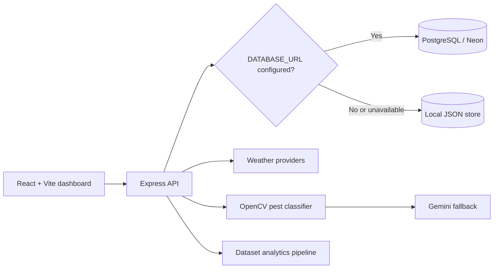

# Smart Agri

A full-stack farm operations dashboard that combines field records, weather data, crop analytics, pest scanning, market information, and farmer-focused advisories in one responsive application.

Smart Agri is built as a resilient prototype: the API can use PostgreSQL for persistent data, but development remains usable through a local JSON store and explicit fallback responses when optional providers are unavailable.

## Core capabilities

- Farmer dashboard with fields, crops, health indicators, alerts, and tasks
- Ten-day weather forecasts with provider fallback behavior
- Pest and disease scan workflow using local OpenCV classification with optional Gemini fallback
- Yield trends, soil-profile analytics, and dataset retraining
- Crop recommendations and live farm insights
- Mandi-price and cold-storage views
- Fertilizer and pesticide tracking
- Hindi-friendly advisory responses and UI content
- PostgreSQL persistence with automatic local JSON fallback
- Responsive React dashboard with charts and reusable feature panels

## Architecture



The API wraps provider-facing routes in controlled fallback handlers. A fallback keeps the interface demonstrable, but responses label their source so simulated or degraded data is not presented as live provider data.

## Technology stack

| Layer | Technology |
| --- | --- |
| Frontend | React 18, React Router, Recharts, Tailwind CSS, Vite |
| Backend | Node.js, Express 5 |
| Persistence | PostgreSQL with `pg`; local JSON fallback |
| ML and vision | Dataset-driven analytics, Python/OpenCV classifier |
| External services | Weather providers and optional Gemini analysis |

## Repository layout

```text
smart_agri/
├── frontend/
│   ├── src/components/    dashboard features and shared UI
│   ├── src/pages/         home and dashboard composition
│   └── src/data/          development/demo data
├── server/
│   ├── controllers/       request and provider orchestration
│   ├── routes/            auth, farm, scanner, frontend, weather
│   ├── services/          analytics and integration logic
│   ├── scripts/           training and database migration tools
│   ├── data/              local store and dataset inputs
│   └── docs/              data-collection guidance
└── README.md
```

## Local development

### Prerequisites

- Node.js 20+
- npm
- Python with `opencv-python` and `numpy` only for local pest classification
- PostgreSQL is optional for development

### 1. Start the API

```bash
git clone https://github.com/Sandeshkumar0/smart_agri.git
cd smart_agri/server
npm install
cp .env.example .env  # Windows: copy .env.example .env
npm run dev
```

The API runs at `http://localhost:8000/api` by default.

### 2. Start the frontend

```bash
cd ../frontend
npm install
npm run dev
```

Vite prints the frontend URL, normally `http://localhost:5173`.

## Configuration

The server includes `.env.example`. Important variables are:

| Variable | Required | Purpose |
| --- | --- | --- |
| `PORT` | No | API port; defaults to `8000` |
| `DATABASE_URL` | No | PostgreSQL connection; local JSON is used without it |
| `OPENWEATHER_API_KEY` | No | OpenWeather integration |
| `WEATHERBIT_API_KEY` | No | Weatherbit integration |
| `INDIAN_WEATHER_API_KEY` | No | Indian weather provider integration |
| `GEMINI_API_KEY` | No | Fallback image/advisory analysis |
| `GEMINI_MODEL` | No | Gemini model selection |
| `FRONTEND_ORIGIN` | No | CORS origin for the frontend |
| `PEST_DATASET_DIR` | No | Local pest-image dataset directory |
| `PEST_PYTHON_BIN` | No | Python executable for OpenCV tooling |
| `PEST_CV_MIN_CONFIDENCE` | No | Confidence threshold before provider fallback |

Never commit populated environment files or provider keys.

## API surface

| Area | Representative endpoints |
| --- | --- |
| Health | `GET /api/health` |
| Demo identity | `POST /api/auth/demo-login` |
| Farms | `GET/POST /api/farm/crops`, `GET/POST /api/farm/fields` |
| Scanning | `GET/POST /api/scanner/scans`, `POST /api/scanner/pest-detect` |
| Weather | `GET /api/weather/forecast10?city=Kendujhar` |
| Analytics | `GET /api/frontend/analytics`, `POST /api/frontend/analytics/retrain` |
| Insights | frontend aggregation routes for fields, soil, crops, mandi, and storage |

See [`server/README.md`](server/README.md) for backend-specific dataset and route details.

## Analytics and pest datasets

Yield and soil analytics can be generated from CSV or JSON crop datasets. A starter schema and data-collection checklist are available under `server/data/templates/` and `server/docs/`.

Run a retraining pass with:

```bash
cd server
npm run train:analytics
```

The local pest dataset follows a directory-per-class convention:

```text
server/data/pest_dataset/
├── healthy/
├── leaf_rust/
└── blast_disease/
```

## Persistence behavior

When `DATABASE_URL` is available, the server initializes PostgreSQL tables for users, crops, fields, scans, pest predictions, weather logs, assistant messages, and compatible application state. Retryable connection errors trigger a documented fallback to `server/data/db.json` so local demos continue to function.

Use the migration helper when moving existing JSON data:

```bash
cd server
npm run migrate:neon
```

## Current limitations

- Frontend signup and login are demo-only and store credentials in browser local storage. They are not production authentication.
- Several dashboard responses can intentionally fall back to sample data when providers are unavailable.
- Pest quality depends on the local dataset and image conditions; results are advisory, not agronomic diagnosis.
- The repository does not yet include a comprehensive automated test suite.
- Secrets, personal farm data, and uploaded images require a production security and retention design.

## Production direction

- Replace demo auth with server-side sessions or token-based authentication and password hashing
- Add farm ownership authorization to every write and query
- Ingest real soil and irrigation telemetry through MQTT
- Add offline-first synchronization for low-connectivity environments
- Report model confidence, dataset version, and provider provenance in every advisory
- Add API, component, and browser integration tests in CI
- Add multilingual accessibility testing and farmer usability studies

## License

No license has been declared yet. Add one before accepting external contributions or reuse.
